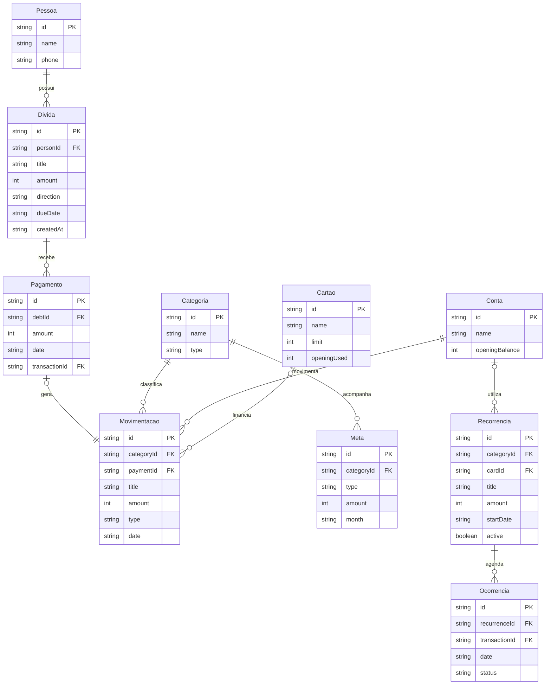

# Organização do Desaperta

## Responsabilidades

- `src/domain/finance.ts`: modelos, regras financeiras, cálculos e validação de backups. Não depende de React Native.
- `src/storage/snapshotRepository.ts`: leitura e gravação de um snapshot versionado, com adaptador substituível nos testes.
- `src/storage/repository.ts`: conecta o repositório ao AsyncStorage.
- `src/state/FinanceContext.tsx`: carrega os registros, serializa as operações de escrita e atualiza a interface somente depois de salvar.
- `src/domain/planning.ts` e `models.ts`: cartões, metas, recorrências e resumo para WhatsApp.
- `src/domain/accounts.ts`: contas com saldos próprios e transferências entre contas.
- `src/state/ThemeContext.tsx`: preferência de tema por dispositivo e adaptação ao sistema.
- `src/screens/`: telas separadas por responsabilidade, incluindo configuração inicial, cartões, metas e recorrências.
- `src/components/`: botões, campos, cartões, filtros, confirmações e itens reutilizáveis.
- `src/navigation/`: abas, pilha de telas, parâmetros tipados e proteção de formulários não salvos.
- `src/services/backup*`: compartilhamento de arquivos no celular e download/seletor de arquivos na web.
- `src/styles/theme.ts`: cores, espaçamentos e aparência dos cartões.

## Dados e relacionamentos

Todos os IDs são strings. Valores monetários são inteiros em centavos; datas são strings `AAAA-MM-DD`, sem conversão por fuso horário. O esquema atual é `4`, com migração dos backups das versões `1`, `2` e `3` preservando o histórico. O saldo inicial pertence a cada conta; transações e recorrências em dinheiro possuem `cashAccountId`. Transferências usam duas transações ligadas por `transferId`, excluídas das receitas, gastos e metas. Compras no crédito guardam a fatura e as parcelas futuras. Veja [Versão 1.3](changelog/VERSAO-1.3.md).

`direction` é `payable` (eu devo) ou `receivable` (me devem). `type` é `income` ou `expense`. `paymentId` é opcional: lançamentos comuns não têm pagamento. As categorias iniciais são fixas nesta versão; pessoas são cadastradas/reutilizadas pelo nome ao salvar pendências.

## Regras importantes

1. Saldo = entradas menos saídas efetivamente registradas. O saldo pode ser negativo.
2. Cadastrar uma pendência não registra a operação inicial de empréstimo nem altera o caixa. Se um empréstimo entrou ou saiu do caixa, sua movimentação inicial deve ser registrada separadamente. Pagamentos posteriores são lançados automaticamente.
3. Cada pagamento gera uma única movimentação vinculada. Os dois registros são persistidos no mesmo snapshot para evitar salvar apenas metade da operação.
4. Desfazer uma baixa remove a movimentação vinculada. Excluir uma dívida remove suas baixas e movimentações, com confirmação que explica o impacto no saldo.
5. Não é permitido pagar além do restante, reduzir o principal abaixo do já pago, inverter o tipo após pagamentos, ou registrar movimentações futuras.
6. Estado e saldo só são atualizados depois da gravação bem-sucedida. Falhas de leitura não criam uma base vazia por cima da existente.
7. A importação valida versão, tamanho, valores, IDs únicos, datas, referências e consistência entre baixas e movimentações. Antes de restaurar, uma cópia do estado atual é guardada em uma chave separada.
8. A checagem de snapshot detecta uma janela desatualizada antes da gravação. Use uma janela por vez para editar; AsyncStorage não oferece transações entre processos.

## Limites desta versão

- Apenas reais (BRL), sem juros, contas bancárias, parcelas automáticas ou sincronização.
- Valores individuais entre R$ 0,01 e R$ 9.999.999,99; datas entre 2000 e 2100.
- Até 10 mil registros por entidade e snapshot de até 5 milhões de caracteres. Para uso cotidiano pequeno, sem banco remoto.
- Dados e backups não criptografados. Não armazene senhas, números de cartão ou documentos no app.
- No navegador, cada combinação de endereço/porta tem dados separados.
- Builds Android foram verificadas por compilação do bundle; teclado, seletor de arquivos e compartilhamento nativos ainda precisam de teste em um aparelho físico.

## Manutenção

Abra `scripts\\windows\\terminal.cmd` ou um terminal nesta pasta. Rode `npm test`, `npm run typecheck`, `npm run check` e `npm run format:check` antes de alterar a versão. Ao mudar o esquema, mantenha um leitor/migração da versão anterior antes de subir o número da versão. Nunca ignore falha de leitura salvando uma base vazia automaticamente.

## Faturas e importação (1.3)

`billing.ts` calcula ciclos e distribui pagamentos antigos. Cada transação de crédito guarda `billMonth`; compras parceladas têm `purchaseId`, `installment` e `installments`. Os centavos são distribuídos em `purchases.ts`, e o validador exige a sequência completa. O limite soma todas as parcelas, mas relatórios e metas usam o mês da fatura. `cycleConfigured` diferencia cartões antigos sem dias confirmados.

`statements.ts` lê CSV/OFX e valida a importação em lote. `importKey` impede reimportação exata; a interface apresenta possíveis repetições e permite ignorar registros. Pagamentos importados usam a mesma função de baixa das faturas. Nenhum extrato é transmitido a um servidor.

`reminders.ts` gera um plano puro de datas; `billNotifications.ts` agenda apenas notificações desta funcionalidade. `ReminderContext` serializa atualizações e expõe erros nas configurações. Permissão é solicitada somente pela ação explícita do usuário no Android.
