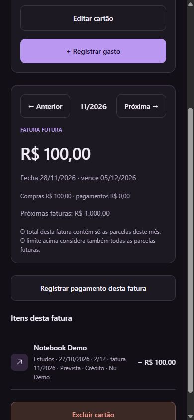
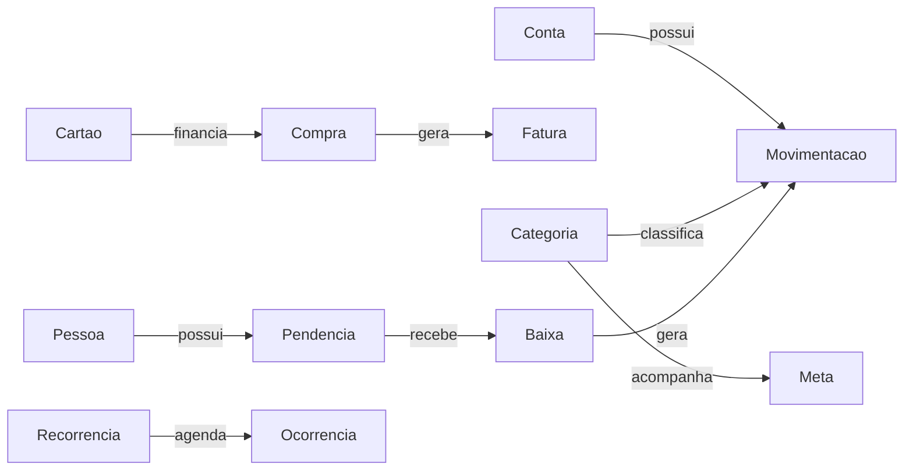

# Documentação do projeto — Desaperta

## 1. Visão geral

O **Desaperta** é um aplicativo mobile de organização financeira pessoal. Ele foi pensado para adolescentes e jovens adultos que precisam acompanhar o dinheiro que possuem, os gastos do dia a dia, o uso do cartão de crédito e as pendências com outras pessoas.

O projeto funciona sem cadastro, sem servidor próprio e sem conexão automática com banco. Cada pessoa registra suas informações no próprio aparelho. Quando deseja aproveitar dados de banco, ela importa um arquivo de extrato e confirma os lançamentos antes de salvá-los.

**Versão documentada:** 1.3.0  
**Plataformas:** Android e navegador para testes  
**Identificador Android:** `br.com.louas.desaperta`  
**Armazenamento principal:** local no dispositivo

## 2. Problema e público-alvo

O controle financeiro costuma ficar espalhado entre conversas, anotações, aplicativos de banco e memória. Esse cenário dificulta responder perguntas simples, como:

- Quanto dinheiro realmente está disponível?
- Quanto do limite do cartão já está comprometido?
- Qual parcela ainda vai aparecer nos próximos meses?
- Quem ainda precisa pagar uma pendência?
- Qual categoria está passando do limite planejado?

O Desaperta reúne essas informações em uma interface direta, com linguagem simples e operações visíveis. O público principal são pessoas que estão começando a administrar cartão, contas e compromissos financeiros, mas o aplicativo também pode ser usado por qualquer pessoa que queira manter um controle pessoal local.

## 3. Objetivos

### Objetivo geral

Oferecer um ambiente simples para registrar e interpretar a vida financeira cotidiana pelo celular.

### Objetivos específicos

- Separar saldos de mais de uma conta.
- Controlar mais de um cartão de crédito e o limite de cada um.
- Distribuir compras parceladas entre a fatura atual e as faturas futuras.
- Registrar entradas, saídas, transferências, recorrências e metas.
- Acompanhar valores que o usuário deve ou tem a receber.
- Importar extratos locais de Nubank e Inter.
- Gerar um resumo claro para enviar pelo WhatsApp.
- Permitir backup e restauração sem depender de um servidor.

## 4. Escopo do aplicativo

### O que o Desaperta faz

| Área | Recursos |
| --- | --- |
| Contas | Cadastro de várias contas, saldo inicial, saldo atual, extrato e transferências internas |
| Cartões | Limite, fechamento, vencimento, faturas, compras parceladas e pagamento de fatura |
| Lançamentos | Entradas, saídas, categorias, busca, filtros e edição |
| Planejamento | Metas mensais de entrada ou saída e lançamentos recorrentes |
| Pendências | Pessoas para quem o usuário deve ou que devem ao usuário, com pagamentos parciais |
| Importação | Arquivos CSV e OFX de Nubank e Inter, prévia e prevenção de duplicação |
| Privacidade | Dados locais, backup JSON e restauração validada |
| Atualizações | Atualizações compatíveis no Android sem reinstalar o APK |

### O que o Desaperta não faz

- Não movimenta dinheiro nem realiza pagamentos bancários.
- Não acessa automaticamente contas de banco ou cartões.
- Não calcula juros, rotativo ou encargos de fatura.
- Não armazena senha, número completo de cartão ou credenciais bancárias.
- Não sincroniza dados entre aparelhos.

Essas limitações são importantes: o aplicativo registra e organiza as informações fornecidas pelo usuário, mas não substitui um banco ou um serviço de Open Finance.

## 5. Experiência de uso

### Configuração inicial

No primeiro acesso, o usuário passa por três etapas:

1. Cadastra uma ou mais contas e informa o saldo inicial de cada uma.
2. Cadastra um ou mais cartões, com limite, valor já usado, dia de fechamento e vencimento.
3. Revisa os dados antes de salvar.

Esse fluxo evita limitar o usuário a uma única conta ou cartão desde o começo.

### Navegação principal

O aplicativo possui cinco áreas fixas na barra inferior:

| Área | Finalidade |
| --- | --- |
| Início | Resumo do saldo, do cartão e dos compromissos do período |
| Carteira | Contas, cartões, limites e faturas |
| Novo | Entrada, saída, compra no cartão, transferência, pendência e importação |
| Extrato | Histórico completo de lançamentos, busca e filtros |
| Mais | Metas, recorrências, pendências, importação, aparência, backup e ajustes |


## 6. Funcionalidades detalhadas

### 6.1 Contas, saldo e transferências

Cada conta mantém seu próprio saldo. Uma entrada aumenta apenas a conta escolhida; uma saída reduz apenas a conta escolhida. O saldo geral exibido no início é a soma das contas cadastradas.

Uma transferência cria dois registros vinculados: uma saída na conta de origem e uma entrada na conta de destino. Para evitar distorção nos relatórios, transferências não contam como receita nem como gasto.

### 6.2 Cartões, faturas e parcelas

O cartão possui limite total, dia de fechamento e dia de vencimento. Uma compra realizada no crédito consome limite, mas não diminui imediatamente o saldo de uma conta. O saldo só é reduzido quando o usuário registra o pagamento da fatura.

Em compras parceladas, o aplicativo distribui as parcelas nas faturas correspondentes. Por exemplo, uma compra de R$ 1.200,00 em 12 vezes aparece como R$ 100,00 em cada fatura. Mesmo que apenas uma parcela esteja na fatura atual, o limite considera o total ainda comprometido pelas parcelas futuras.

Compras realizadas no dia de fechamento ou depois dele entram na próxima fatura. O usuário pode navegar entre faturas, visualizar itens futuros e registrar pagamento parcial ou total da fatura selecionada.



### 6.3 Entradas, saídas e categorias

O aplicativo permite criar receitas e despesas com título, valor, categoria, data e conta. O Extrato permite localizar registros por texto e filtrar por tipo e período.

Os valores monetários são armazenados internamente em centavos. Essa decisão evita erros de arredondamento comuns em cálculos com números decimais.

### 6.4 Metas financeiras

Uma meta pode ser de dois tipos:

- **Teto de saída:** por exemplo, gastar no máximo R$ 30,00 em Alimentação no mês.
- **Objetivo de entrada:** por exemplo, receber R$ 500,00 em uma categoria de renda.

O progresso é atualizado pelos lançamentos reais do mês. Parcelas futuras não são contabilizadas antecipadamente como gasto atual.

### 6.5 Recorrências

Entradas e saídas recorrentes representam valores previsíveis, como salário, Spotify, academia ou transporte. O aplicativo agenda ocorrências mensais e exige que o usuário confirme ou ignore cada uma. Dessa forma, uma previsão não altera o saldo antes de realmente acontecer.

### 6.6 Pendências com outras pessoas

O recurso de Pendências possui duas direções:

- **Eu devo:** compromissos que o usuário precisa pagar.
- **Me devem:** valores que outra pessoa precisa pagar ao usuário.

Cadastrar a pendência não altera o saldo, pois o empréstimo original pode ter acontecido fora do período de controle. Quando o usuário registra um pagamento ou recebimento, o aplicativo cria a movimentação financeira correspondente e atualiza o valor restante.

O resumo para WhatsApp organiza itens pendentes, pagamentos já realizados e saldo final. Ele abre a mensagem preenchida para revisão; o envio continua sendo uma ação do usuário.


### 6.7 Importação de extratos

O Desaperta aceita arquivos **CSV** e **OFX** locais. Há suporte a formatos de extrato de Nubank e Inter, incluindo separadores diferentes, textos com aspas, valores brasileiros e arquivos com acentuação Latin-1.

O fluxo de importação é o seguinte:

1. O usuário escolhe uma conta ou cartão e seleciona o arquivo.
2. O aplicativo lê o conteúdo no próprio dispositivo.
3. Uma prévia mostra cada linha e permite ajustar categoria ou ignorar registros.
4. O usuário confirma a importação.
5. O aplicativo registra uma chave de importação para impedir que o mesmo lançamento seja importado novamente.

Para extratos de cartão, o usuário informa a fatura de destino. O aplicativo não inventa parcelas futuras que não estejam no arquivo.

### 6.8 Tema e acessibilidade visual

O visual utiliza grafite e roxo como identidade principal. O usuário pode escolher tema claro, escuro ou seguir o tema do sistema. A interface prioriza contraste, campos legíveis, ícones consistentes e poucas ações por tela.

### 6.9 Backup e recuperação

Em Ajustes, o usuário pode exportar os dados em JSON e importar um backup posteriormente. Antes de restaurar, o aplicativo valida versão, referências, identificadores, datas e consistência entre pagamentos e lançamentos. Uma cópia do estado anterior é preservada para reduzir o risco de perda.

No navegador, o armazenamento local depende do endereço e da porta. Por isso, dados registrados em `localhost:8081` não aparecem automaticamente em `localhost:8085`.

## 7. Dados, privacidade e segurança

Os dados financeiros ficam no armazenamento local do aparelho por meio de AsyncStorage. No navegador, ficam no armazenamento local daquele navegador e endereço.

O aplicativo não envia lançamentos, extratos ou backups para um servidor próprio. A atualização de aplicativo utiliza o serviço EAS Update apenas para entregar código compatível do app Android; ela não transmite o conteúdo financeiro armazenado localmente.

Os backups JSON não são criptografados. Por isso, o usuário deve guardá-los em local seguro e não incluir senhas, documentos ou dados de cartão.

## 8. Arquitetura e tecnologias

| Camada | Responsabilidade |
| --- | --- |
| `src/screens` | Telas e fluxos que o usuário visualiza |
| `src/components` | Elementos reutilizáveis de interface |
| `src/navigation` | Abas, rotas e proteção contra saída com formulário não salvo |
| `src/domain` | Regras financeiras, faturas, parcelas, importação, metas e mensagens |
| `src/state` | Estado compartilhado do app, tema e lembretes |
| `src/storage` | Leitura e gravação do snapshot versionado |
| `src/services` | Backup, arquivos, compartilhamento e notificações |
| `tests` | Testes automatizados das regras principais |

Principais tecnologias:

- React Native 0.81.5
- Expo SDK 54
- React 19.1
- TypeScript
- React Navigation
- AsyncStorage
- Expo FileSystem, DocumentPicker, Sharing, Notifications e Updates

### Modelo de dados simplificado



O arquivo principal de dados usa o esquema de versão 4. Ele possui migrações das versões 1, 2 e 3 para preservar dados de versões anteriores.

## 9. Atualizações do aplicativo

O APK Android 1.3.0 inclui o mecanismo de atualizações remotas. Ao abrir o app, uma atualização compatível pode ser buscada e baixada. Em **Mais → Ajustes → Atualizações do app**, o usuário também pode verificar manualmente e reiniciar após o download.

Atualizações de telas, textos, regras e correções de importação podem chegar sem novo APK. Mudanças em bibliotecas nativas, permissões, ícones ou versão do Expo exigem uma nova compilação Android.

## 10. Como executar o projeto

### Requisitos de desenvolvimento

- Node.js 22 e npm.
- Dependências instaladas com `npm install`.
- Para Android, Expo Go compatível com Expo SDK 54 ou o APK do projeto.

### Comandos principais

```sh
npm run web
npm start
npm test
npm run typecheck
npm run check
npm run format:check
```

No Windows, os atalhos `scripts/windows/iniciar-web.cmd` e `scripts/windows/iniciar-celular.cmd` preparam o ambiente local e executam os comandos correspondentes.

Para instalar o APK e conhecer o processo de compilação, consulte [ANDROID.md](ANDROID.md). Para entender o mecanismo de atualização, consulte [ATUALIZACOES.md](ATUALIZACOES.md).

## 11. Qualidade e validação

O projeto possui 49 testes automatizados cobrindo, entre outros pontos:

- Saldos de múltiplas contas e transferências.
- Fechamento de fatura, parcelas, limite e pagamentos.
- Distribuição correta de centavos nas parcelas.
- Migração e validação de backup.
- Importação CSV/OFX, arquivos com acentos e prevenção de duplicidade.
- Metas e recorrências.
- Pendências, pagamentos parciais e resumo para WhatsApp.
- Lembretes com datas válidas e fim de mês.

Além dos testes automatizados, as telas web foram verificadas com dados fictícios. Funções que dependem do sistema operacional, como notificação, seletor de arquivo, compartilhamento e aplicação de atualização remota, devem ser conferidas em um aparelho Android antes de uma distribuição ampla.

## 12. Limitações e melhorias futuras

As próximas evoluções possíveis incluem:

- Integração com Open Finance, mediante consentimento do usuário e uso de servidor seguro.
- Sincronização opcional e criptografada entre aparelhos.
- Cálculo de juros, multas, rotativo e parcelamento de fatura.
- Mais formatos de extrato e conciliação automática de transações.
- Relatórios e gráficos de longo prazo.

Essas melhorias precisam preservar os princípios atuais do projeto: clareza, controle pelo usuário e privacidade dos dados financeiros.

## 13. Referências internas

- [README do projeto](../README.md)
- [Arquitetura detalhada](ARQUITETURA.md)
- [Instalação Android](ANDROID.md)
- [Atualizações sem APK](ATUALIZACOES.md)
- [Registro de validação](VALIDACAO.md)
- [Histórico da versão 1.3](changelog/VERSAO-1.3.md)
